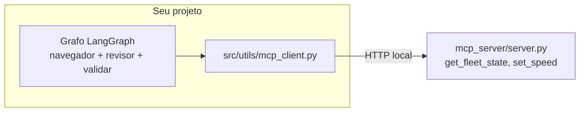
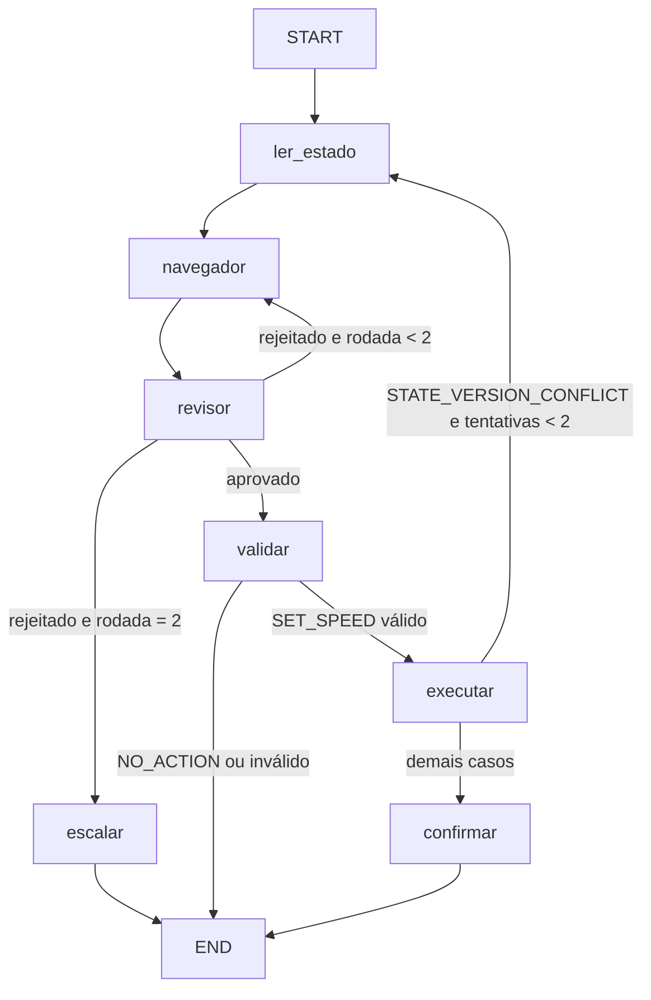

# Semana 2, exercício 2 (completo): a frota via servidor MCP

**Quando:** fim da semana (quarta a sexta). **Tema:** MCP e multiagente, parte 2. **Dados:** [`dados/situacao_tempestade.json`](dados/situacao_tempestade.json). **Pré-requisito:** exercício 1 da semana 2.

## O desafio, em poucas palavras

No exercício anterior, os dois agentes só **conversavam**. No desafio final, eles precisam **agir**: enviar comandos aos navios. E eles **não falam direto com o simulador**. A cadeia técnica é:

```text
telemetria → agentes → servidor MCP → API de transações → simulador
```

O **servidor MCP** é a porta de entrada dos comandos. Ele expõe **ferramentas** (tools) com contrato rígido e aplica regras de proteção. Duas delas importam muito:

| Proteção | Para que serve |
|---|---|
| `expected_state_version` | o agente informa em qual versão do estado baseou a decisão. Se o navio já mudou, o comando é rejeitado (`STATE_VERSION_CONFLICT`), evitando agir sobre informação velha |
| `idempotency_key` | se o mesmo comando for enviado duas vezes (por timeout, retry), o efeito acontece **uma só vez** |

Neste exercício você vai **construir um servidor MCP pequeno**, ligar seus dois agentes a ele e provar que essas proteções funcionam.

## O que você vai aprender

- O que é MCP: servidor, cliente e **tools** com schema.
- Criar um servidor MCP com uma tool de leitura e uma **tool mutável**.
- Consumir tools MCP dentro de um grafo LangGraph (nós assíncronos).
- **Idempotência** e **versão de estado** na prática.
- Combinar o laço proponente/revisor com uma **validação determinística** antes de executar.

## As regras do problema

Mesmas regras do exercício 1 (tempestade: 12 nós na rota direta e 15 nós na protegida; velocidades de 0 a 18 nós, em passos de 0,5), mais:

| Regra | Descrição |
|---|---|
| Versão de estado | cada navio tem `state_version`. Todo comando bem-sucedido a incrementa em 1 |
| Idempotência | chave repetida devolve a resposta original e **não** altera o estado de novo |
| Erros | `STATE_VERSION_CONFLICT` (versão velha) e `INVALID_SCHEMA` (velocidade inválida) |
| Chave | `treino:<navio>:SET_SPEED:v<versão>` (mesma decisão sobre a mesma versão gera a mesma chave) |

## A arquitetura



O servidor roda **em outro terminal**, como um serviço separado. Isso reproduz o desenho do desafio (o agente não acessa o estado dos navios diretamente).

Acréscimos à estrutura do projeto:

```text
ocean-agents/
  mcp_server/
    server.py          # servidor MCP (fica fora de src: é um serviço externo)
  scripts/
    testar_mcp.py      # teste direto das tools, sem LLM
  src/utils/
    mcp_client.py      # cliente MCP e ajuda para ler os resultados
```

## O grafo que você vai construir



| Nó | Tipo | O que faz |
|---|---|---|
| `ler_estado` | tool MCP | chama `get_fleet_state` e escolhe o navio (com a `state_version` atual) |
| `navegador` | agente (LLM) | igual ao exercício 1 |
| `revisor` | agente (LLM) | igual ao exercício 1 |
| `validar` | código | confere faixa, passo e limite de tempestade **em código**, mesmo com o revisor tendo aprovado |
| `executar` | tool MCP | chama `set_speed` com `expected_state_version` e `idempotency_key` |
| `confirmar` | código | transforma a resposta do servidor em texto |
| `escalar` | código | sem acordo entre os agentes |

## Passo a passo

### Parte A: o servidor MCP

1. Instale: `pip install "langchain[mcp]"`. Isso traz o **FastMCP** (para criar o servidor) e o módulo `langchain.mcp` (para consumir as tools). O módulo está em beta e mostra um aviso (`LangChainBetaWarning`) na primeira importação. A biblioteca antiga `langchain-mcp-adapters` foi arquivada: não a use.
2. Crie `mcp_server/server.py` com duas tools:
   - `get_fleet_state()`: devolve os navios com a `state_version`;
   - `set_speed(ship_id, speed_kn, expected_state_version, idempotency_key)`: valida, confere versão, aplica e incrementa a versão; é idempotente.
3. Rode o servidor em um terminal separado: `python mcp_server/server.py`.

### Parte B: testar as tools sem LLM

Crie `scripts/testar_mcp.py` e confira, nesta ordem, com o servidor recém-iniciado:

| # | Chamada | Resultado esperado |
|---|---|---|
| 1 | `set_speed("S1-FAROL", 12, 1, "treino:S1-FAROL:SET_SPEED:v1")` | `committed`, `state_version` 2, `duplicate: false` |
| 2 | a mesma chamada de novo | `duplicate: true`, `state_version` continua 2 |
| 3 | `set_speed("S1-FAROL", 11, 1, "outra-chave")` | erro `STATE_VERSION_CONFLICT` (versão atual é 2) |
| 4 | `set_speed("S1-FAROL", 12.3, 2, "chave-3")` | erro `INVALID_SCHEMA` (fora do passo de 0,5) |

Reinicie o servidor antes da parte C para voltar ao estado inicial.

### Parte C: o grafo com os dois agentes

1. Crie `src/utils/mcp_client.py` (cliente e leitura de resultados).
2. Reaproveite do exercício 1: `navegador`, `revisor`, prompts e `routing.py`. Troque o `receive` por `ler_estado`, que agora **chama o MCP**.
3. Crie `validar`, `executar` e `confirmar`.
4. No `routing.py`, acrescente `route_after_validate` e `route_after_execute`.
5. Monte o `builder.py` e rode com `asyncio.run(...)`. Os nós que chamam o MCP são **assíncronos** (`async def`).

### Parte D: experimento de conflito

Force um conflito para ver o grafo se recuperar: no `executar`, quando `tentativas == 0` e a variável `SIMULAR_CONFLITO` estiver ativa, envie `state_version - 1` em `expected_state_version`. O servidor responde `STATE_VERSION_CONFLICT`, e o grafo deve **reler o estado** e concluir na segunda tentativa.

## Resultado esperado

Com o servidor recém-iniciado e o S1-FAROL:

```text
S1-FAROL: velocidade ajustada de 14 para 12.0 nós (state_version 2)
```

No servidor, o `S1-FAROL` passa a ter `velocidade_alvo_kn = 12.0` e `state_version = 2`.

Na parte D, com `SIMULAR_CONFLITO=1`, o log mostra uma tentativa rejeitada por `STATE_VERSION_CONFLICT` e uma segunda tentativa com sucesso:

```text
tentativa 1: STATE_VERSION_CONFLICT
tentativa 2: committed (state_version 2)
```

## Como verificar

- [ ] O servidor está em um processo separado e o grafo só o acessa pelo cliente MCP.
- [ ] Os quatro testes da parte B passam.
- [ ] O estado do servidor só muda quando o revisor aprova **e** a validação em código passa.
- [ ] Repetir o mesmo comando não altera o estado de novo.
- [ ] Na parte D, o grafo relê o estado e conclui, sem repetir a mesma tentativa às cegas.
- [ ] Nenhum erro é "engolido": a resposta do servidor aparece no resultado.

## Para pensar

1. Por que repetir um comando **com a mesma chave** é seguro e repetir **com chave nova** não é?
2. O que `STATE_VERSION_CONFLICT` protege? Por que **não** se repete a mesma chamada automaticamente nesse caso?
3. O revisor já aprovou. Por que ainda validar em código antes de executar?
4. No desafio final, o servidor MCP **deriva a identidade do agente do token** e rejeita comandos que tragam `team_id` ou `agent_id` no payload. Que ataque isso evita?

## Desafio extra (opcional)

- Adicione a tool `hold(ship_id, expected_state_version, idempotency_key)` e deixe o navegador usá-la.
- Adicione um **timeout** na chamada `set_speed` e uma política de retry **somente** para erro de indisponibilidade, reaproveitando a mesma chave.
- Rode os 3 navios em sequência e confira as versões de estado no servidor.

---

# Como resolver (gabarito do instrutor)

## Ideia geral

MCP (Model Context Protocol) padroniza como um cliente descobre e chama **tools** de um servidor. O agente não conhece a implementação: conhece **nome, descrição e schema** de cada tool. O servidor é quem aplica regras, versões e idempotência.

Três camadas de proteção, cada uma no seu lugar:

1. **Revisor (LLM):** julga a proposta.
2. **`validar` (código):** garante as regras, independente do LLM.
3. **Servidor MCP:** garante versão de estado e idempotência, independente do cliente.

## `mcp_server/server.py`

```python
import json
from pathlib import Path

from fastmcp import FastMCP

DADOS = Path(__file__).resolve().parent.parent / "dados" / "situacao_tempestade.json"

mcp = FastMCP("ocean")
FROTA = {n["id"]: n for n in json.loads(DADOS.read_text(encoding="utf-8"))["navios"]}
RESPOSTAS: dict[str, dict] = {}  # chave de idempotência -> resposta original


def _erro(code: str, message: str) -> dict:
    return {"error": {"code": code, "message": message}}


@mcp.tool
def get_fleet_state() -> dict:
    """Snapshot dos navios, incluindo state_version."""
    return {"navios": list(FROTA.values())}


@mcp.tool
def set_speed(
    ship_id: str, speed_kn: float, expected_state_version: int, idempotency_key: str
) -> dict:
    """Define a velocidade-alvo (0 a 18 nós, passo 0,5). Mutável e idempotente."""
    if idempotency_key in RESPOSTAS:
        return {**RESPOSTAS[idempotency_key], "duplicate": True}

    navio = FROTA.get(ship_id)
    if navio is None or not 0 <= speed_kn <= 18 or (speed_kn * 2) % 1 != 0:
        return _erro("INVALID_SCHEMA", "navio inexistente ou velocidade fora da faixa ou do passo")
    if navio["state_version"] != expected_state_version:
        return _erro(
            "STATE_VERSION_CONFLICT",
            f"esperado {expected_state_version}, atual {navio['state_version']}",
        )

    antes = navio["velocidade_alvo_kn"]
    navio["velocidade_alvo_kn"] = speed_kn
    navio["state_version"] += 1
    resposta = {
        "status": "committed",
        "ship_id": ship_id,
        "before": antes,
        "after": speed_kn,
        "state_version": navio["state_version"],
        "duplicate": False,
    }
    RESPOSTAS[idempotency_key] = resposta
    return resposta


if __name__ == "__main__":
    mcp.run(transport="http", host="127.0.0.1", port=8000)
```

Pontos para comentar:

- A docstring vira a **descrição da tool** que o modelo lê.
- A idempotência vem **primeiro**: se a chave já existe, nada é reavaliado.
- Só respostas **bem-sucedidas** são memorizadas; erros não são, porque o agente deve poder tentar de novo com dados corretos.
- O estado fica em memória no servidor, que por isso precisa ser **reiniciado** para voltar ao início. No desafio, existe um ledger (registro) imutável e persistente.
- O servidor escuta em `http://127.0.0.1:8000/mcp`.

## `src/utils/mcp_client.py`

```python
import json
import os

from langchain.mcp import MCPAdapter

MCP_URL = os.getenv("MCP_URL", "http://127.0.0.1:8000/mcp")

_tools: dict | None = None


async def get_tools_by_name() -> dict:
    global _tools
    if _tools is None:
        async with MCPAdapter(MCP_URL) as adapter:
            _tools = {t.name: t for t in await adapter.list_tools()}
    return _tools


def parse_result(raw) -> dict:
    if isinstance(raw, dict):
        return raw
    if isinstance(raw, list):
        bloco = raw[0]
        raw = bloco["text"] if isinstance(bloco, dict) else bloco
    return json.loads(raw)
```

`MCPAdapter` descobre as tools dentro do `async with`. As tools devolvidas guardam o cliente, então **continuam utilizáveis depois que o contexto fecha**; cada chamada abre e fecha a sua própria sessão. Por isso o cache em `_tools` funciona.

O resultado de uma tool MCP pode chegar como texto JSON ou como lista de blocos de conteúdo, conforme a versão da biblioteca. `parse_result` isola essa diferença em um só lugar. Um erro **reportado pelo servidor como falha de execução** (`isError`) chegaria como mensagem de erro; neste servidor, os erros do contrato são **dados** (`{"error": ...}`), e é o grafo que decide o que fazer com eles.

## `scripts/testar_mcp.py`

```python
import asyncio

from src.utils.mcp_client import get_tools_by_name, parse_result


async def main() -> None:
    tools = await get_tools_by_name()
    set_speed = tools["set_speed"]

    async def chamar(ship, kn, versao, chave):
        raw = await set_speed.ainvoke(
            {"ship_id": ship, "speed_kn": kn, "expected_state_version": versao, "idempotency_key": chave}
        )
        return parse_result(raw)

    print("1", await chamar("S1-FAROL", 12, 1, "treino:S1-FAROL:SET_SPEED:v1"))
    print("2", await chamar("S1-FAROL", 12, 1, "treino:S1-FAROL:SET_SPEED:v1"))
    print("3", await chamar("S1-FAROL", 11, 1, "outra-chave"))
    print("4", await chamar("S1-FAROL", 12.3, 2, "chave-3"))


if __name__ == "__main__":
    asyncio.run(main())
```

Execute com `python -m scripts.testar_mcp` (adicione `scripts/` ao projeto; como não há `__init__.py`, o Python 3 trata a pasta como pacote de namespace).

## Estado, prompts, `navegador` e `revisor`

Reaproveite do exercício 1. Só o estado ganha campos:

```python
from typing import TypedDict


class State(TypedDict, total=False):
    ship_id: str
    navio: dict
    proposta: dict
    revisao: dict
    rodada: int
    valido: bool
    resposta_mcp: dict
    tentativas: int
    resultado: str
```

## Nós novos

`src/graph/nodes/ler_estado.py`:

```python
from src.graph.state import State
from src.utils.mcp_client import get_tools_by_name, parse_result


async def ler_estado(state: State) -> dict:
    tools = await get_tools_by_name()
    frota = parse_result(await tools["get_fleet_state"].ainvoke({}))["navios"]
    navio = next(n for n in frota if n["id"] == state["ship_id"])
    return {"navio": navio, "rodada": 0, "revisao": {}}
```

Ao reler o estado, a `rodada` e a `revisao` voltam ao início: a decisão anterior se baseava em uma versão velha.

`src/graph/nodes/validar.py`:

```python
from src.graph.state import State

LIMITE_TEMPESTADE_KN = {"direta": 12.0, "protegida": 15.0}


def validar(state: State) -> dict:
    proposta, navio = state["proposta"], state["navio"]
    if proposta["acao"] == "NO_ACTION":
        return {"valido": False, "resultado": f"{navio['id']}: nenhuma ação necessária"}

    v = proposta["velocidade_kn"]
    valido = v is not None and 0 <= v <= 18 and (v * 2) % 1 == 0
    if valido and navio["em_tempestade"]:
        valido = v <= LIMITE_TEMPESTADE_KN[navio["rota"]]
    if valido:
        return {"valido": True}
    return {"valido": False, "resultado": f"{navio['id']}: proposta bloqueada pela validação em código"}
```

`src/graph/nodes/executar.py`:

```python
import os

from src.graph.state import State
from src.utils.mcp_client import get_tools_by_name, parse_result


async def executar(state: State) -> dict:
    navio, proposta = state["navio"], state["proposta"]
    tentativas = state.get("tentativas", 0)
    versao = navio["state_version"]
    chave = f"treino:{navio['id']}:SET_SPEED:v{versao}"

    versao_enviada = versao
    if os.getenv("SIMULAR_CONFLITO") and tentativas == 0:  # experimento da parte D
        versao_enviada = versao - 1

    tools = await get_tools_by_name()
    raw = await tools["set_speed"].ainvoke(
        {
            "ship_id": navio["id"],
            "speed_kn": proposta["velocidade_kn"],
            "expected_state_version": versao_enviada,
            "idempotency_key": chave,
        }
    )
    return {"resposta_mcp": parse_result(raw), "tentativas": tentativas + 1}
```

A chave depende da **decisão e da versão lida**, não de um número aleatório. Assim, um retry da mesma decisão reaproveita a chave.

`src/graph/nodes/confirmar.py`:

```python
from src.graph.state import State


def confirmar(state: State) -> dict:
    r, navio = state["resposta_mcp"], state["navio"]
    if "error" in r:
        return {"resultado": f"{navio['id']}: falha {r['error']['code']} ({r['error']['message']})"}
    return {
        "resultado": f"{navio['id']}: velocidade ajustada de {r['before']} para {r['after']} nós "
        f"(state_version {r['state_version']})"
    }
```

`escalar` é o mesmo do exercício 1.

## `src/graph/routing.py`

```python
from langgraph.graph import END

from src.graph.state import State

MAX_RODADAS = 2
MAX_TENTATIVAS = 2


def route_after_review(state: State) -> str:
    if state["revisao"]["aprovado"]:
        return "aprovado"
    return "tentar_de_novo" if state["rodada"] < MAX_RODADAS else "esgotado"


def route_after_validate(state: State) -> str:
    return "executar" if state["valido"] else END


def route_after_execute(state: State) -> str:
    erro = state["resposta_mcp"].get("error")
    if erro and erro["code"] == "STATE_VERSION_CONFLICT" and state["tentativas"] < MAX_TENTATIVAS:
        return "reler"
    return "confirmar"
```

## `src/graph/builder.py`

```python
from langgraph.graph import END, START, StateGraph

from src.graph.nodes.confirmar import confirmar
from src.graph.nodes.escalar import escalar
from src.graph.nodes.executar import executar
from src.graph.nodes.ler_estado import ler_estado
from src.graph.nodes.navegador import navegador
from src.graph.nodes.revisor import revisor
from src.graph.nodes.validar import validar
from src.graph.routing import route_after_execute, route_after_review, route_after_validate
from src.graph.state import State


def build_graph():
    graph = StateGraph(State)
    graph.add_node("ler_estado", ler_estado)
    graph.add_node("navegador", navegador)
    graph.add_node("revisor", revisor)
    graph.add_node("validar", validar)
    graph.add_node("executar", executar)
    graph.add_node("confirmar", confirmar)
    graph.add_node("escalar", escalar)

    graph.add_edge(START, "ler_estado")
    graph.add_edge("ler_estado", "navegador")
    graph.add_edge("navegador", "revisor")
    graph.add_conditional_edges(
        "revisor",
        route_after_review,
        {"aprovado": "validar", "tentar_de_novo": "navegador", "esgotado": "escalar"},
    )
    graph.add_conditional_edges(
        "validar", route_after_validate, {"executar": "executar", END: END}
    )
    graph.add_conditional_edges(
        "executar", route_after_execute, {"reler": "ler_estado", "confirmar": "confirmar"}
    )
    graph.add_edge("confirmar", END)
    graph.add_edge("escalar", END)
    return graph.compile()
```

## `src/app/main.py`

```python
import asyncio

from src.graph.builder import build_graph
from src.utils.langfuse_client import flush, run_config


async def main() -> None:
    graph = build_graph()
    for ship_id in ["S1-FAROL", "S2-MARE", "S3-CORAL"]:
        saida = await graph.ainvoke({"ship_id": ship_id}, config=run_config())
        print(saida["resultado"])
    flush()


if __name__ == "__main__":
    asyncio.run(main())
```

Com nós assíncronos, use `ainvoke` e `asyncio.run`.

## O que comentar com a turma

- **Tool mutável × tool de leitura.** `get_fleet_state` só lê. `set_speed` muda o mundo, por isso exige versão e chave.
- **Idempotência.** Timeouts acontecem. Sem a chave, um retry poderia duplicar uma compra ou uma mudança. Com a chave, o servidor devolve a resposta original (`duplicate: true`).
- **Conflito de versão não é retry cego.** Quem recebe `STATE_VERSION_CONFLICT` precisa **reler o estado e decidir de novo**: a informação em que se baseou ficou velha. É o que `reler` faz.
- **Defesa em camadas.** O revisor pode errar, o servidor pode ser mal usado. A validação em código fica no meio.
- **Identidade.** No desafio, quem é o agente vem do **token**, não do payload. O servidor deste exercício não faz isso (simplificação), mas o conceito deve ser dito em aula.
- **Ponte para a semana 3.** Os agentes até aqui conhecem as regras por prompt. Na semana 3, as regras e os dados chegam por **documento**, consultados com RAG.
